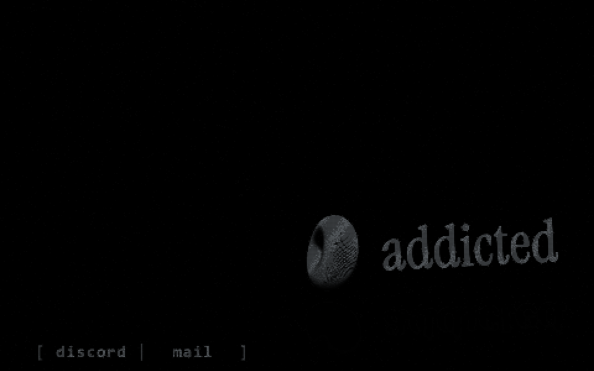
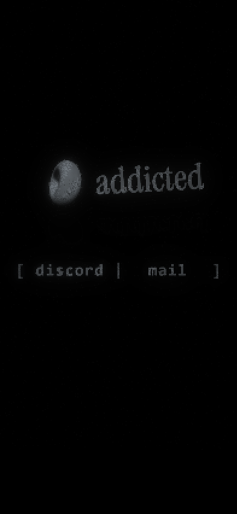

# addicted-ascii audit — 14 September 2026

Audited local `main` at `8bc9e9e`, with fixes on `codex/audit-ascii`. The initial
working tree was clean. Deployment status is outside this audit. The GitHub
connector returned 404 for the main branch; the matching local repository contains
the complete history used for this audit.

The application remains one `index.html`, without a build step or runtime package
dependencies. `audit/` contains review evidence and browser diagnostics, not website
assets. Publish only the application file, not the repository root.

## Method and limits

Chrome 153.0.8010.37 on Windows, driven with the bundled Playwright runtime. Tests
opened the actual page through `file://`. Font-controlled runs fulfilled the Google
Fonts stylesheet and Instrument Serif Latin WOFF2 from a captured local copy;
offline runs refused both requests. Layout screenshots freeze animation at the same
time. Physical DPR 3 is simulated; the application's `maxDpr: 2` cap still applies.

**No physical phone, Safari, Firefox, screen-reader session, or Discord/Twitter
in-app browser was available.** Device-shaped Chromium windows and shortened canvas
boxes are simulations. I did not change the intentional idle dim on an unverified
webview hypothesis. The soundtrack is absent, so audible playback was not verified.

## Phase 0: reproduce and fix the bracket failure

The supplied failure percentages are not portable across installed monospace fonts,
font arrival timing, and grid alignment. With Instrument Serif loaded deterministically,
this Windows baseline measured:

| Viewport / DPR | Original self-test | Original bracket cells lit | Final self-test | Final bracket cells lit |
|---|---|---:|---|---:|
| 1440×900 / 1 | 126 pass, 0 fail | 10.71% | 139 pass, 0 fail | 11.85% |
| 800×600 / 1 | 125 pass, 1 fail | 0%; empty bracket region | 139 pass, 0 fail | 11.23% |
| 1280×720 / 1 | 125 pass, 1 fail | 7.86% | 139 pass, 0 fail | 11.51% |
| 393×852 / 3 | 126 pass, 0 fail | 11.28% | 139 pass, 0 fail | 11.28% |

The first uncontrolled network run also failed at 1440×900. Font state was not
captured at the instant of that assertion; the separate delayed-font experiment
confirmed a possible late swap. This is why the audit pins font availability before
comparing results. Raw results: `audit/baseline.json`,
`audit/network-baseline.json`, `audit/probe.json`, and `audit/final.json`.

There were two defects. Stacked rows contained only their words: the renderer
omitted brackets altogether. Inline bracket strokes could be split between cells,
leaving too few cells above the test's luminance threshold. The test's region also
includes whitespace, making it alignment-sensitive, but the remedy does not depend
on redefining that region. Stacked rows now retain and budget both brackets. A stroke
reinforcement of `linkFrameStroke × effective pitch` protects the frame's ink without
raising its colour. This was 0.4 backing pixels at the original four-pixel pitch.

**No assertion threshold was relaxed.** The original 9% lit-cell minimum, 0.18
luminance cutoff, 0.13 contact-ink minimum, and 60% subordination ceiling remain.
The test now addresses cells using the effective pitch. Final frame/word mean-ink
ratios are 0.415, 0.475, 0.437 and 0.483 respectively, all below 0.60. A separate
assertion detects missing brackets in stacked rows.

## Phase 1: property audit

Verdicts describe the final verified state. “BROKEN → HOLDS” identifies a measured
defect corrected here. “Not verified” is deliberately not presented as a passing
verdict.

| Item | Property | Expected | Measured now | Verdict |
|---|---|---|---|---|
| A1 | Wordmark and reflection inside visible phone viewport | Entire composition within visible canvas | 393×852, canvas 393×746, DPR 3: conservative rotated envelope y=245.2–424.1 CSS px; contacts end at 466.5; all inside 746. Same geometry before/after. | HOLDS in simulation |
| A2 | Layout, backing grid and hit targets use the canvas box | Canvas height 746, not screen height 852 | `vpH=746`, backing 786×1492; targets are scaled from that layout. `getBoundingClientRect()` remains the measurement source. | HOLDS for tested sizes |
| A3 | Toolbar-only resize does not re-tile | 0 re-tiles | 2 real dispatched resize events → 2 resize calls → same source surface and luminance array. | HOLDS |
| A4 | No font swap moves the lockup after painting | 0 px change | Delayed font: lockup buffer width 807→686 before; 807→807 after. The chosen face and derived pitch are committed at boot. | BROKEN → HOLDS |
| A5 | Copy feedback does not move other contact words or slot centres | 0 px | Neighbour x movement 0; changed word's centre movement 0. Its ink expands symmetrically inside its existing slot, as intended by `42d754f`. | HOLDS |
| A6 | “copied!” follows success, with fallback | Truthful success/failure | Awaited native-success, native-refusal/fallback-success, and both-refused checks pass. Failures now count in the returned self-test total. OS clipboard contents were not independently read. | HOLDS for tested decision paths |
| A7 | Touch can highlight and then cool a word | Released/cancelled touch is not stuck hot | Chromium touchscreen tap previously ended `_hot=true`; now false. Pointer cancellation also clears it. Focus remains on the contact for keyboard access. | BROKEN → HOLDS in simulation |
| B1 | Every source text keeps 6 x-height cells | ≥6 at scale 1 and minScale, through quality ladder | Baseline examples: 640×480 @1, scale .5: wordmark 4.00, contacts 2.75, gate 4.50 at pitch 4. At pitch 8 contacts reached 1.375. Full-scale contacts also failed: minimum 4.00 desktop, 5.50 phone. Final sweep minimum: 6.00 for desktop and phone. | BROKEN → HOLDS |
| B2 | Legibility coverage exists in current suite | Runnable coverage against current layout | 192,708 desktop and 148,356 phone text measurements, using the same metrics/layout helpers as rendering. Checks include all three requested quality pitches and both scales. | GONE → HOLDS |
| B3 | Report failure and obtain approval before larger fix | Measured proposal first | Reported the 4.00/2.75-cell failures before changing pitch; owner replied “do whatever you think is best.” Effective pitch is now capped by actual text x-height. Costs below. | HOLDS |
| C1 | Visible-viewport assertions on named devices | Exercise actual element measurement | Added iPhone 15 393×746, small-phone 375×559 and tall-phone 412×807 canvas checks. The latter two visible heights are test fixtures, not measured browser-chrome dimensions. | GONE → HOLDS |
| C2 | Negative control: innerHeight layout hides the phone tail | Demonstrate original clipping mechanism | Under the new centred portrait layout, even a full 852px canvas has its tail at 466.5, still inside 746. Requiring it to clip would be a false assertion. Actual-box measurement and rotated-envelope checks replace that control. | OBSOLETE for current portrait composition |
| C3 | Unchanged viewport assertion | No new surfaces | Added same-source/same-grid assertions for each shortened canvas; dispatched-event test also passes. | GONE → HOLDS |
| C4 | Pitch/floor assertion | Current mechanism protected | Restored the 6-cell floor; parameter remains in `PARAMS`. Integer pitch is an upper bound on the quality request. | GONE → HOLDS |
| C5 | Font gate assertion | Slow CSS/font cannot move art | `audit/behavior.cjs` delays stylesheet and font separately, asserts boot occurred by the 2.1s observation, and asserts unchanged width after release. | GONE → HOLDS |

The legibility sweep covers desktop widths 640–3840 in 32px increments, heights
480–2160 in 32px increments, DPR 1/2; phones 320–500 by 480–1100 in 4px increments,
aspect ratios 1.5–2.4, DPR 2/3. It measures each actual font's `x` bounding height.
Every case is evaluated at scales 1/.5 and requested pitches 4/6/8. This is a sampled
viewport-space sweep, not a claim about every possible real number, arbitrary user
parameter, or other operating system's fonts. The runtime cap uses measurements at
the actual size, including sizes between those samples.

The merge really did omit the earlier pitch law and scale floor; `fa0b46c` explicitly
says so. The lost identifiers alone would not prove a regression; the numbers above
do. Conversely, whole-file diff counts exaggerated the later changes: ignoring line
endings, `fff033a` is +104/−13 and `42d754f` is +20/−5. Those counts are not evidence
that thousands of lines of behavior were discarded.

## Phase 2: previously unreviewed work

| Item | Property | Expected | Measured now | Verdict |
|---|---|---|---|---|
| Entry keyboard access | Door usable, then focus reaches contacts | One Tab and Enter; gate leaves tab order | Real keyboard input enters, focuses first contact; second `enter()` leaves entry timestamp unchanged. Existing native button, name and inert handling retained. | HOLDS |
| Entry during slow loading | Slow third-party CSS must not block application boot | Fallback can start after font deadline | With CSS held for 2.1s, baseline had not executed the application; final page had booted on fallback. CSS is nonblocking; font choice is frozen at boot. | BROKEN → HOLDS |
| Entry during quality experiment | No provisional correction appears after entry | Finish or undo experiment before opening | `reveal()` now undoes a pending unverified step, then freezes adaptation. Browser check confirms exactly one undo. | BROKEN → HOLDS |
| Entry accessibility beyond keyboard | Usable with assistive technology | Actual screen-reader verification | DOM exposes a named native button and contact button roles; no screen-reader session was available. With JavaScript disabled or a fatal script initialization error, the canvas-only artwork has no textual fallback. | Not verified; limitation retained |
| Portrait breakpoint | Both layouts fit and 1px jitter does not flip composition | Stable near ratio .8 | At 799×1000 vs 800×1000, baseline top edge jumped 323.5→747.2px. A 2-CSS-pixel resize deadband removes flips for 799/800/801 jitter; explicit 803 and 797 crossings still switch. Initial selection remains ratio <.8. | BROKEN → HOLDS |
| Quality convergence | Bounded adjustments across all controls | Stop hunting | Synthetic 100ms fine-grid / 10ms coarse-grid case: 570 re-tiles after 40,000 samples and still adapting before; 6 re-tiles then stopped after. Counter now includes effects and grid changes, not only resolution. | BROKEN → HOLDS |
| Quality geometry | Corrections are not visible after entry | Frozen after entry, except actual surface changes | Existing freeze retained; font swap prevented; provisional step reverted before opening. Synthetic quality and entry checks pass. The small-window floor prevents quality requests from destroying text. | HOLDS for tested paths |
| Wordmark centring, `37d5c6b` | Word centred on donut, ink stays in buffer | Existing centre/containment assertions | Both retained and passing in the final four-view matrix. No evidence requiring a change to this alignment. | HOLDS |
| `drafts.html`, `b2d15ae` | Establish whether sketches are production content | Known publishing intent | Tracked 8,635-byte standalone sketches page, unlinked from index. Root hosting would expose it. Ignored `_public/` contains only index, but no authoritative deployment configuration is tracked. | Not verified; left alone |
| In-app browser idle state | Do not boot dimmed because of false focus | Physical webview reproduction | No handset/webview connected. Focus overrides were confined to the test harness. | Not verified; idle behavior unchanged |

The existing gate is canvas artwork with an invisible semantic button, not an
additional HTML design surface. No restyling, portrait redesign, feature removal,
draft deletion, or idle-policy change was made. The old “eight cells tall” assertion
measured em height, not x-height; it remains as a layout check alongside the actual
six-x-height floor.

## Measured rendering tradeoff

Same machine and browser; full effects, auto-quality disabled, 60 warm-up frames then
120 measured inter-rAF intervals. Chromium was launched with frame-rate limiting and
GPU vsync disabled. These are uncapped rendering intervals, not user-facing FPS,
device benchmarks, or a guarantee for Firefox/Safari. Script time was recorded
separately; conclusions use wall-clock frame intervals.

| Viewport / scale / requested pitch | Effective pitch before → after | Grid cells before → after | Mean interval before → after | p95 before → after |
|---|---|---|---|---|
| 1440×900 @1 / 1 / 4 | 4 → 3 | 81,000 → 144,000 | 10.45 → 12.51 ms | 12.6 → 14.7 ms |
| 800×600 @1 / 1 / 4 | 4 → 3 | 30,000 → 53,400 | 5.53 → 5.98 ms | 7.1 → 7.2 ms |
| 393×852 @3 / 1 / 4 | 4 → 4 | 83,922 → 83,922 | 9.40 → 9.37 ms | 10.9 → 11.2 ms |
| 640×480 @1 / .5 / 8 | 8 → 1 | 1,200 → 76,800 | 3.59 → 6.18 ms | 4.3 → 7.0 ms |

The cost is real: in the extreme small/coarse case, rendering uses 64 times as many
cells to preserve the required text floor. Measured total frame cost grew by about
72%, not 64 times; the source and compositing costs are shared. I retained the floor
instead of silently sacrificing legibility. Raw intervals are summarized in
`audit/performance.json`.

## Evidence and reproduction

Production verification: open `index.html?selftest`. The four font-controlled and
four offline views
finish with **139 passed, 0 failed**, including 341,064 x-height measurements per
run. `?fps` now displays effective cell pitch. `audit/behavior.cjs` and
`audit/verify.cjs` use assertions and exit nonzero when their checks fail. The three
clipboard outcomes are awaited and counted before the self-test reports success;
previously an unconditional pass was counted before those tests finished.

The browser harness uses the machine's bundled Playwright installation and installed
Chrome; it is not an application dependency. From the repository directory:

```text
node audit/run.cjs final
node audit/run.cjs offline
node audit/behavior.cjs index.html audit/behavior-after.json
node audit/verify.cjs
node audit/perf.cjs
```

`audit/baseline.html` is the unmodified `8bc9e9e` snapshot used for comparisons.
`audit/font.css` and `audit/instrument.woff2` are captured test fixtures. The page
does not reference them. Intermediate experimental files are not needed to run the
application.

Before/after desktop, 1440×900:




Before/after simulated phone, 393×852 @3 with a 746px visible canvas:




The remaining verification gap is real hardware/browser coverage, not an inferred
pass. The ignored `_public/index.html` is an older local deploy copy and was not
overwritten; no deployment target was established or changed in this audit.
